# 📐 KIẾN TRÚC HỆ THỐNG & NGUYÊN LÝ HOẠT ĐỘNG

Tài liệu này trình bày chi tiết về cấu trúc mã nguồn, nguyên lý hoạt động của các thuật toán AI, thị giác máy tính và các nghiệp vụ phân tích giao thông trong dự án.

---

## 1. CẤU TRÚC THƯ MỤC VÀ TRÁCH NHIỆM MÔ-ĐUN

Dự án được tổ chức theo kiến trúc phân tầng **Clean OOP Architecture**:

```text
Tracffic_AI_Project/
├── configs/
│   └── camera_configs.json          # Cấu hình độc lập (Vạch đếm, ROI, Giới hạn tốc độ, Hướng làn) cho từng Cam
├── core/
│   ├── config_manager.py            # Đọc/ghi cấu hình CameraConfig (JSON)
│   ├── detector.py                  # Multi-Model AI Ensemble (YOLOv8s + VN Vehicle + VN Sign) + ByteTrack
│   ├── tracker_analytics.py         # Đo tốc độ (km/h), kiểm tra ngược chiều, đếm xe, đo mật độ ROI
│   ├── plate_anpr.py                # Nhận diện & trích xuất biển số Full HD ANPR + tạo biên bản phạt nguội
│   ├── database.py                  # Lưu trữ vi phạm vào SQLite & tự động đồng bộ file CSV
│   └── renderer.py                  # Vẽ vạch ROI mờ, quỹ đạo di chuyển (trail), nhãn tốc độ và bảng HUD
├── ui/
│   ├── video_canvas.py              # Widget QLabel hiển thị video + bắt sự kiện chuột vẽ ROI/Vạch đếm
│   └── main_window.py               # Giao diện chính PyQt6 Dark Theme tích hợp toàn bộ hệ thống
├── models/
│   ├── sign_model.pt                # Model YOLO nhận diện 58 loại biển báo giao thông Việt Nam
│   └── vehicle_model.pt             # Model YOLO chuyên nhận diện xe máy Việt Nam
├── videos/                          # Thư mục chứa 4 kịch bản video Full HD
├── violations/                      # Thư mục lưu cơ sở dữ liệu SQLite, file CSV và ảnh biên bản
├── main.py                          # Điểm khởi chạy chính
├── step2_business_logic.py          # Script chuyển tiếp tương thích ngược
└── requirements.txt                 # Danh mục thư viện phụ thuộc
```

---

## 2. NGUYÊN LÝ CỦA TẦNG AI ĐA MÔ HÌNH (MULTI-MODEL ENSEMBLE)

### 2.1. Sự kết hợp của 3 mô hình YOLOv8
1. **`yolov8s.pt` (Base Model):** Nhận diện 4 nhóm xe theo tập chuẩn quốc tế COCO:
   - Ô tô (`Car` - Class 2)
   - Xe máy (`Motorbike` - Class 3)
   - Xe buýt (`Bus` - Class 5)
   - Xe tải (`Truck` - Class 7)
2. **`models/vehicle_model.pt` (Vietnamese Vehicle Model):** Được train riêng trên tập dữ liệu xe cộ Việt Nam. Hệ thống sử dụng mô hình này ở ngưỡng tin cậy thấp (`conf=0.15`) để quét bù các xe máy ở xa hoặc góc khuất mà mô hình chuẩn bỏ sót.
3. **`models/sign_model.pt` (Vietnamese Sign Model):** Nhận diện 58 mã biển báo chuẩn Việt Nam theo Quy chuẩn QCVN 41:2019/BGTVT, tiêu biểu là biển cấm xe tải `P.106a`.

### 2.2. Thuật toán khử trùng lặp (IoU Deduplication)
Để tránh trường hợp cả `base_model` và `vn_model` cùng nhận diện một chiếc xe máy tạo ra 2 hộp bao trùng nhau:
- Mỗi khi `vn_model` phát hiện một phương tiện, hệ thống tính chỉ số **Intersection over Union (IoU)** với toàn bộ các hộp bao đã có từ `base_model`:
  $$\text{IoU}(Box_A, Box_B) = \frac{\text{Area}(Box_A \cap Box_B)}{\text{Area}(Box_A \cup Box_B)}$$
- Nếu $\text{IoU} \le 0.20$, phương tiện mới được chấp nhận và gán mã nhận diện phụ (`extra_id >= 7000`).

---

## 3. NGUYÊN LÝ CÁC NGHIỆP VỤ PHÂN TÍCH GIAO THÔNG

### 3.1. Đếm xe qua vạch nghiêng bất kỳ (Line Segment Intersection)
Hệ thống sử dụng thuật toán kiểm tra hướng quay hình học (Counter-Clockwise - CCW).
Với đoạn dịch chuyển của xe từ tâm cũ $P_1(x_{t-1}, y_{t-1})$ đến tâm mới $P_2(x_t, y_t)$, và đoạn thẳng vạch đếm nối giữa 2 mút $Q_1(u_1, v_1)$ và $Q_2(u_2, v_2)$:
- Hàm hướng quay:
  $$\text{CCW}(A, B, C) = (C_y - A_y)(B_x - A_x) > (B_y - A_y)(C_x - A_x)$$
- Xe được tính là cắt qua vạch khi và chỉ khi:
  $$\text{CCW}(P_1, Q_1, Q_2) \neq \text{CCW}(P_2, Q_1, Q_2) \quad \text{và} \quad \text{CCW}(P_1, P_2, Q_1) \neq \text{CCW}(P_1, P_2, Q_2)$$
*Thuật toán này cho phép người dùng kéo chuột vẽ vạch đếm ở bất kỳ vị trí và góc nghiêng nào trên mặt đường.*

### 3.2. Đo tốc độ thực tế (km/h) có bù trừ phối cảnh (Perspective Compensation)
Vì camera giao thông nhìn theo góc xiên, cùng một độ dịch chuyển $\Delta y = 10\text{ px}$ trên màn hình:
- Ở chân màn hình (gần camera): Xe chỉ đi được $\approx 0.5\text{ m}$.
- Ở đỉnh màn hình (xa camera): Xe thực tế đã đi được $\approx 2.5\text{ m}$.

Hệ thống tính toán hệ số bù trừ phối cảnh:
$$\text{factor}(y) = 1.0 + 1.35 \times \frac{460 - y}{340}$$
Quãng đường thực tế:
$$d = \sqrt{(\Delta x \times 0.85)^2 + (\Delta y \times \text{factor}(y))^2} \times \text{meters\_per\_pixel}$$
Vận tốc tức thời và làm mượt bằng bộ lọc hàm mũ (Exponential Moving Average - EMA):
$$v_{\text{raw}} = \frac{d}{\Delta t} \times 3.6 \quad (\text{km/h})$$
$$v_{\text{smooth}}^{(t)} = 0.65 \times v_{\text{smooth}}^{(t-1)} + 0.35 \times v_{\text{raw}}$$

### 3.3. Đo mật độ đa giác ROI & Cảnh báo kẹt xe
Hệ thống sử dụng hàm `cv2.pointPolygonTest` để đếm số lượng tâm xe $(c_x, c_y)$ nằm bên trong đa giác ROI:
- Nếu $\text{vehicles\_in\_roi} \ge \text{congestion\_threshold}$ (mặc định 9–14 xe tùy camera), thẻ trạng thái chuyển sang `CONGESTED` với viền đỏ nhấp nháy.

---

## 4. QUY TRÌNH PHẠT NGUỘI & ANPR FULL HD

Khi một xe kích hoạt vi phạm (Đi vào đường cấm `P.106a`, Chạy quá tốc độ hoặc Đi ngược chiều):

```mermaid
flowchart LR
    DetectViolation["1. Phát hiện Vi phạm (Canvas 854x480)"] --> Project1080["2. Ánh xạ tọa độ lên Frame Full HD (1920x1080)"]
    Project1080 --> CropVeh["3. Cắt ảnh phương tiện độ nét cao"]
    CropVeh --> PlateDetect["4. Định vị biển số (Sobel X + Morphology)"]
    PlateDetect --> OCRBadge["5. Trích xuất ký tự OCR & Gán tem kiểm định"]
    OCRBadge --> CompositeReport["6. Tạo Biên bản tổng hợp 1180x480"]
    CompositeReport --> SaveDB["7. Ghi SQLite & CSV Log"]
```



Biên bản tổng hợp được lưu dưới dạng file `.jpg` bao gồm:
1. Ảnh hiện trường toàn cảnh có hộp đỏ đánh dấu xe vi phạm.
2. Ảnh phóng to phương tiện trích xuất từ khung hình gốc 1080p.
3. Ảnh cận cảnh biển số kèm dải đọc ký tự OCR chuẩn mực (`OCR: 29H-436.20`, `60C-470.80`...).
4. Bảng thông số: Biển số, Lỗi vi phạm, Loại xe, Tốc độ ghi nhận, Camera và Thời gian vi phạm.
